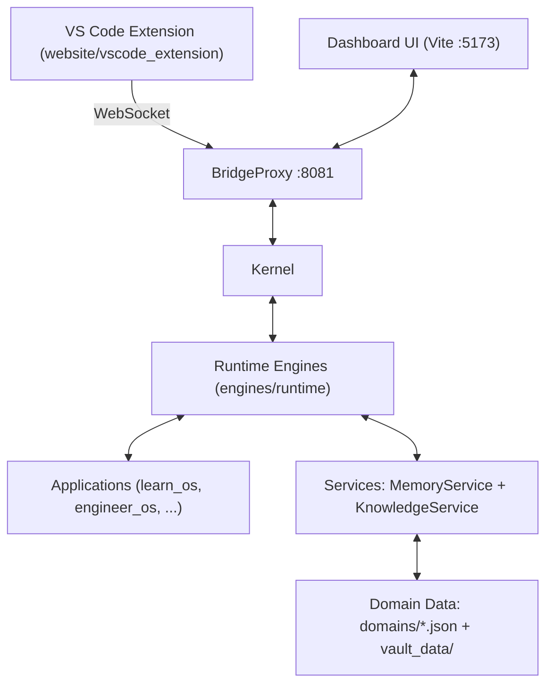

# AI-OS — Artificial Intelligence Operating System

[](https://github.com/Girish3012-AD/My-Personal-Agent/releases/tag/v1.0.0)
[](https://github.com/Girish3012-AD/My-Personal-Agent)
[](LICENSE)
[](package.json)

**Plain-English pitch** — AI-OS is a locally-run "operating system" for autonomous agents. It combines three tightly coupled pieces:

1. **Core runtime** (`kernel/`, `engines/runtime/`) — parses user intent, plans execution, coordinates services, and validates results.
2. **VS Code extension** (`website/vscode_extension/`) — proxies editor commands to the runtime via a WebSocket bridge.
3. **Dashboard UI** (`dashboard/`) — a Vite-powered browser front-end that visualises agents, tasks, and knowledge graphs.

Together they let any developer or recruiter run a fully-local AI-OS instance that can **learn**, **engineer**, **research**, **plan careers**, or **bootstrap a startup** — no external API keys required.

<!-- TODO: Add dashboard / VS Code Mastery Tracker screenshot -->

---

## System Architecture



**Layer roles**

| Layer | Role |
|-------|------|
| **VS Code Extension** | Forwards VS Code commands to the local bridge via WebSocket. |
| **BridgeProxy** | HTTP/WS gateway on port 8081; handles start/stop lifecycle (`start.sh` / `START.bat`). |
| **Kernel** | Receives raw intent, builds an execution plan, and orchestrates services (`InputProcessor`, `IntentAnalyzer`, `PlanningManager`, `ExecutionCoordinator`, `ValidationManager`). |
| **Runtime Engines** | Concrete execution layer: `TaskRouter`, `ExecutionPlanner`, `ResultAggregator`, `CircuitBreaker`. |
| **Applications** | LearnOS, EngineerOS, ResearchOS, CareerOS, StartupOS — each exposing a typed public API. |
| **Services** | In-process `MemoryService` (key/value persistence) and `KnowledgeService` (lazy-loaded domain JSON). |
| **Domain Data** | Static JSON mastery playbooks (`domains/`) and runtime vault (`vault_data/`) used by the engines. |

---

## Core Modules

| Module | Status | Input → Action → Output |
|--------|--------|--------------------------|
| **LearnOS** | **Active** | Curriculum goal → `CurriculumGenerator`, `ConceptTeacher`, `PracticeSynthesizer`, `MasteryAssessor` → JSON curriculum + UI view |
| **EngineerOS** | **Active** | Code spec → `ArchitecturePlanner`, `CodeSynthesizer`, `QualityReviewer`, `DeploymentPlanner` → generated source files + quality report |
| **ResearchOS** | **Beta** | Research query → `KnowledgeService` lazy-loads domain graph → structured notes and citations |
| **CareerOS** | **Beta** | Resume + job posting → skill gap analysis → ATS-optimized resume and interview feedback |
| **StartupOS** | **Planned** | Lean-Canvas outline → MVP scaffold (directory skeleton; core logic not yet wired) |

> `Active` = fully implemented and covered by health-check scripts. `Beta` = engine present, some features missing. `Planned` = stub only.

---

## Tech Stack & Prerequisites

| Requirement | Detail |
|-------------|--------|
| **Node.js** | >= 22.6.0 (required for `--experimental-strip-types` used in `start.sh`) |
| **Package manager** | npm |
| **Language** | JavaScript (ES modules) + TypeScript (compiled on-the-fly, no build step) |
| **VS Code** | 1.80+ (for the extension host) |
| **OS** | Linux/macOS/WSL — `./start.sh` · Windows — `dashboard\START.bat` |
| **Env vars** | None — runs fully offline; all data is local JSON files |

---

## Installation & Quick Start

```bash
# 1. Clone
git clone https://github.com/Girish3012-AD/My-Personal-Agent.git
cd My-Personal-Agent

# 2. Install dependencies (single package: ws)
npm ci
```

**Linux / macOS / WSL**
```bash
./start.sh
```

**Windows**
```cmd
dashboard\START.bat
```

Both launchers print a 4-step boot sequence and confirm the proxy is running.

```
[1/4] Environment Check...
[2/4] Initializing KERNEL-001...
[3/4] Auto-Starting Core Services...
[4/4] Attaching VS Code Extension Host Proxy...
======================================
   AI-OS ECOSYSTEM IS 100% ONLINE
======================================
```

Then open VS Code → **Ctrl+Shift+P** → **`AIOS: Open Mastery Tracker`** → dashboard appears at `http://localhost:5173`.

---

## Usage Walkthrough

1. Start the system (`./start.sh` or `START.bat`).
2. In VS Code, run **`AIOS: Open Mastery Tracker`** — dashboard opens at `http://localhost:5173`.
3. Choose **LearnOS → New Curriculum** and type `frontend_mastery`.
4. The runtime parses intent → `CurriculumGenerator` builds a 6-week syllabus → `ConceptTeacher` writes lesson notes → `PracticeSynthesizer` generates exercises → `MasteryAssessor` produces a grading rubric.
5. The dashboard shows a live progress bar and markdown view of the curriculum. Click **Export → JSON** to save the output for downstream use by EngineerOS.

No internet connection or API keys required at any step.

---

## Verification & Testing

```bash
node verify_system_final.js
```

Expected successful output:

```
✔ Kernel initialized
✔ BridgeProxy listening on 8081
✔ MemoryService wrote ping → pong
✔ KnowledgeService loaded dsa_mastery
✔ EngineerOS QualityReviewer returned complexity metric
All checks passed.
```

Each `verify_*.js` script isolates one subsystem (e.g., `verify_engineer.js`, `verify_research_ui.js`). Run any individually with `node <script>` to debug a single layer.

---

## Repository Structure

```
My-Personal-Agent/
├── applications/
│   ├── career_os/
│   ├── engineer_os/
│   │   ├── ArchitecturePlanner.ts
│   │   ├── CodeSynthesizer.ts
│   │   ├── DeploymentPlanner.ts
│   │   ├── QualityReviewer.ts
│   │   └── ui/
│   ├── learn_os/
│   │   ├── engines/
│   │   │   ├── ConceptTeacher.js
│   │   │   ├── CurriculumGenerator.js
│   │   │   ├── MasteryAssessor.js
│   │   │   └── PracticeSynthesizer.js
│   │   └── ui/
│   ├── project_os/
│   ├── research_os/
│   └── startup_os/
├── dashboard/
│   └── START.bat               # Windows one-click launcher
├── domains/                    # JSON mastery / playbook files
├── engines/
│   └── runtime/
│       ├── CircuitBreaker.js
│       ├── ExecutionCoordinator.ts
│       ├── ExecutionPlanner.js
│       ├── ResultAggregator.js
│       └── TaskRouter.js
├── kernel/
│   ├── ContextManager.js
│   ├── ExecutionCoordinator.js
│   ├── InputProcessor.js
│   ├── IntentAnalyzer.js
│   ├── PlanningManager.js
│   ├── ReasoningManager.js
│   └── ValidationManager.js
├── services/
│   ├── knowledge_service/
│   └── memory_service/
├── website/
│   └── vscode_extension/
│       └── src/
│           └── proxy.ts        # WebSocket bridge to kernel
├── start.sh                    # Linux/macOS/WSL bootloader
├── package.json
└── README.md
```

---

## Documentation, Roadmap & Contributing

- **Docs** — [`docs/`](docs/)
- **Changelog** — [CHANGELOG.md](CHANGELOG.md)
- **Contributing** — [CONTRIBUTING.md](CONTRIBUTING.md)
- **License** — [LICENSE](LICENSE) (MIT)

### Roadmap

- [x] Core kernel & runtime services (Memory, Knowledge, BridgeProxy)
- [x] LearnOS engine suite (curriculum generation, mastery assessment)
- [x] EngineerOS code synthesis & quality review
- [x] Health-check test suite (`verify_system_final.js` and friends)
- [ ] ResearchOS full paper ingestion pipeline
- [ ] CareerOS ATS-optimized resume builder
- [ ] StartupOS Lean-Canvas generator & MVP scaffolding

---

Enjoy experimenting with a fully-local, multi-agent AI operating system!
