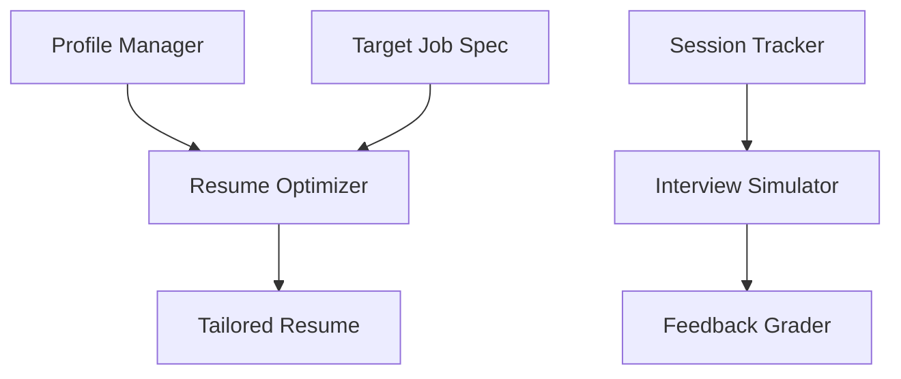

# CareerOS Engine Architecture & Specification
**Module ID**: SYS-SPEC-004  
**Version**: 1.0.0  
**Traceability Reference**: REQ-CAR-001, REQ-CAR-002, REQ-CAR-003  

---

## 1. Executive Summary
CareerOS is designed to manage user professional growth, optimize resumes based on target job descriptions, simulate interactive mock interviews, and compile projects from `ProjectVault` into portfolio sites.



---

## 2. Core Schema Structures

### A. Resume Optimization Schema
- **Module ID**: LRN-ENG-CAR-01
- **Traceability**: REQ-CAR-001
- **JSON Structure**:
```json
{
  "profile_snapshot_id": "prof_12345",
  "target_job_spec": {
    "title": "Senior Software Engineer",
    "company": "AI-Corp",
    "keywords": ["TypeScript", "Distributed Systems", "API Design"]
  },
  "alignment_score": 0.85,
  "suggested_modifications": [
    {
      "section": "Experience",
      "original_text": "Built web services in JavaScript",
      "optimized_text": "Designed and deployed low-latency APIs in TypeScript, optimizing performance by 25%"
    }
  ]
}
```

### B. Interview Simulation Prompt Parameter Schema
- **Module ID**: LRN-ENG-CAR-02
- **Traceability**: REQ-CAR-002
- **Structure**:
```json
{
  "session_id": "int_sim_9876",
  "difficulty_level": "Mid-Senior",
  "technical_focus": ["System Design", "Concurrency"],
  "mock_interviewer_persona": "Technical Team Lead",
  "assessment_criteria": ["Correctness", "Clarity", "System Design Patterns"]
}
```

---

## 3. Mock Interview Simulation Flows

1. **Setup**: The user requests a session. `CareerOS` fetches context from `MemoryService.ProfileManager`.
2. **Execution**:
   - `MockInterviewer` generates behavioral and technical questions.
   - User answers are logged via `SessionTracker`.
3. **Assessment**: `FeedbackGrader` evaluates responses and computes a skill delta value, which is pushed back to `MemoryService.UpdateProfile` (e.g., adding +5 to `system_design`).
