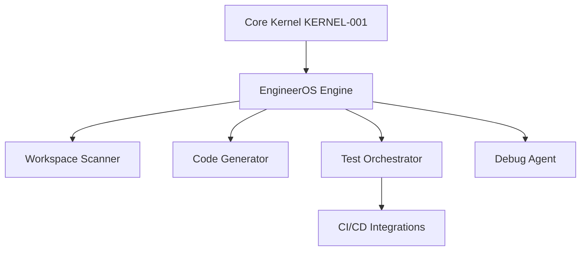

# EngineerOS Architecture & Specification
**Module ID**: SYS-SPEC-002  
**Target Domain**: Software Engineering, Multi-Agent Coding, CI/CD, and Automated Debugging

---

## 1. Overview
EngineerOS is a dedicated application layer running on the AI-OS Core kernel designed to automate developer tasks, manage local workspaces, generate unit test frameworks, and coordinate code refactoring operations.

## 2. Core Workflows

### A. Code Generation & Refactoring
- **Input**: Natural language task descriptions or high-level architecture plans.
- **Action**: Resolves context using `MemoryService.ProjectVault` to read files, uses `Kernel.PlanningManager` to create diff patches, and applies changes.
- **Traceability**: All generated files must contain code references pointing back to parent requirements.

### B. Automated Debugging (Self-Healing Loop)
1. **Trigger**: Compiler error or unit test failure.
2. **Analysis**: The Debug Agent parses the error log and trace files.
3. **Execution**: Formulates refactoring patches and runs target compile scripts.
4. **Validation**: Passes execution back to `ValidationManager` to confirm resolution.

### C. Deployment & Delivery
- Standard pipelines for building local artifacts, running lint checking, and shipping changes to staging servers.
