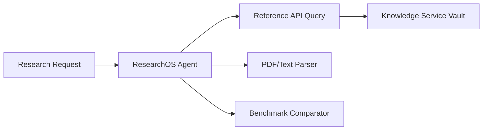

# ResearchOS Architecture & Specification
**Module ID**: SYS-SPEC-003  
**Target Domain**: Model Benchmarking, Lit Review, Data Mining, and Market Trends Analysis

---

## 1. Overview
ResearchOS is a specialized intelligence engine leveraging AI-OS Core services to query research archives, catalog paper summaries, analyze model benchmarks, and compile intelligence reports.

## 2. Core Workflows

### A. Academic & Reference Mining
- **Ingestion**: Scrapes and downloads technical papers (ArXiv, IEEE, etc.).
- **Annotation**: Extracts claims, core formulas, and citations, formatting them as nodes in the `ConceptGraph`.

### B. LLM & Model Benchmarking
- Running evaluations against custom prompt lists, scoring accuracy, tracking inference speeds, and compiling comparison charts.

### C. Market Research Compilation
- Aggregates trends, competitor pricing, and developer community adoption metrics.
