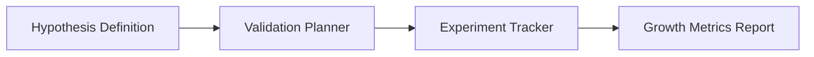

# StartupOS Engine Architecture & Specification
**Module ID**: SYS-SPEC-005  
**Version**: 1.0.0  
**Traceability Reference**: REQ-STU-001, REQ-STU-002, REQ-STU-003  

---

## 1. Executive Summary
StartupOS is a validation and business experiment runtime designed to structure startup hypotheses, generate standard Business Model Canvases, build landing page codes, and track validation growth experiments.



---

## 2. Core Schema Structures

### A. Business Model Canvas Generation Schema
- **Module ID**: LRN-ENG-STU-01
- **Traceability**: REQ-STU-002
- **Structure**:
```json
{
  "canvas_id": "canvas_345",
  "project_name": "AI-OS Platform",
  "segments": {
    "value_propositions": ["Autonomous multi-agent orchestration for engineering workflow automation."],
    "customer_segments": ["DevOps Teams", "Indie Hackers", "R&D Managers"],
    "channels": ["Self-host GitHub", "Cloud Marketplace"],
    "revenue_streams": ["SaaS Subscription", "Enterprise Custom Engines"]
  }
}
```

### B. Growth Experiment Tracker Schema
- **Module ID**: LRN-ENG-STU-02
- **Traceability**: REQ-STU-003
- **Structure**:
```json
{
  "experiment_id": "exp_889",
  "hypothesis": "Developers prefer self-hosted CLI observers over complex web portals.",
  "metrics": {
    "target_metric": "Sign-up conversion rate",
    "minimum_viable_criteria": 0.15,
    "actual_metric": 0.22
  },
  "status": "VALIDATED",
  "confidence_score": 0.90
}
```

---

## 3. Experiment Execution Loop
1. **Creation**: User defines a hypothesis via `ValidationPlanner`.
2. **Setup**: The engine deploys a landing page and configures metric collection.
3. **Execution**: Traffic data is fed to the `ExperimentTracker`.
4. **Conclusion**: Computes conversion percentage and saves results into `MemoryService.ProjectVault` as validated/invalidated business evidence.
